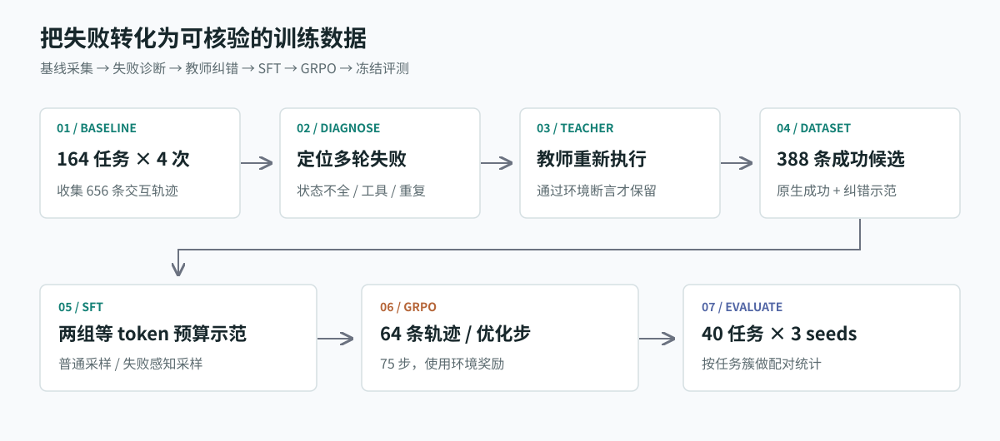
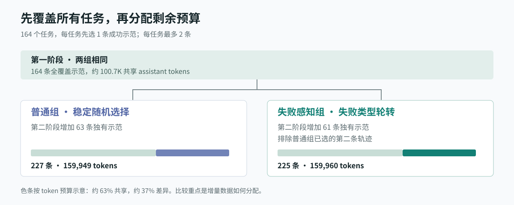
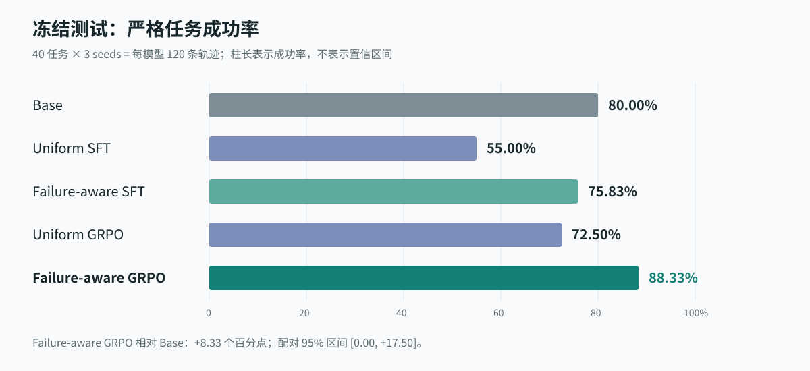

# 电信 Agent 失败驱动后训练

**从一次基线失败采集出发，理解多轮工具型 Agent 的数据构建、SFT、GRPO 与可靠评测。**

本项目基于 [tau2-bench](https://github.com/sierra-research/tau2-bench) 电信客服域与 Qwen3.5-2B，研究一个具体问题：在相同训练预算下，围绕失败任务分配数据，是否比普通采样更有效？



这是一份可以运行的 Agent 后训练案例：先观察模型如何失败，再把失败转化为训练信号，最后用独立任务检查效果。项目包含两组 SFT、两组 GRPO，以及五模型、三随机种子的完整评测。

## 你会学到什么

| 学习问题 | 对应实现 |
| --- | --- |
| 工具调用正确，为什么任务仍可能失败？ | 多轮环境状态、工具执行和严格成功断言 |
| 如何把失败轨迹变成训练数据？ | 失败分类、离线教师纠错、成功示范筛选 |
| 如何设计有差异且预算相近的对照组？ | 全任务覆盖、两阶段采样、约 160K assistant tokens |
| SFT 与 GRPO 分别学习什么？ | 成功示范模仿、在线交互奖励与组内比较 |
| 如何判断提升是否可靠？ | 冻结测试、三 seed 重复测量、任务簇配对 bootstrap |

建议先读完方法与结果，再沿文末的代码阅读路线进入实现。

## 1. 任务：客服需要改变环境状态

Agent 要处理移动数据、MMS 和业务服务故障，需要询问用户、查询账户与设备状态、选择工具并修改设置。例如，“无法上网”可能同时涉及飞行模式、数据节省、漫游和套餐状态；只解决其中一个原因，任务仍可能失败。

```text
用户描述问题 → Agent 查询或调用工具 → 环境返回结果
            → 用户反馈 → Agent 继续处理 → 环境断言判定成功与否
```

**成功取决于环境状态与任务断言。** 回答听起来合理，不等于任务完成；项目不依赖另一个 LLM 判断最终成功与否。

| 划分 | 任务数 | 用途 |
| --- | ---: | --- |
| 训练池 | 164 | 64 个官方训练任务 + 100 个扩展任务 |
| 开发集 | 10 | checkpoint 选择 |
| 冻结测试集 | 40 | 最终模型比较 |

另有 5 个 smoke 任务用于验证执行链路。训练池与开发、测试集不共享完全相同的故障签名。划分规则见 [项目设计](docs/PROJECT_DESIGN.md)。

## 2. 数据：从失败中收集成功示范

先让 base 对每个训练任务执行 4 次，得到 **656 条基线轨迹**，其中 86 条严格成功，570 条以轮数上限终止。这提示我们：瓶颈不仅在单次回复，还在持续完成多步操作。

随后，对至少失败一次的任务使用离线教师重新执行。教师可以读取任务真值，但生成的示范必须通过环境断言，才能进入训练池。

| 阶段 | 轨迹数 | 严格成功数 |
| --- | ---: | ---: |
| 训练任务上的基线采集 | 656 | 86 |
| 教师纠错 | 310 | 302 |
| 合并后的有效 SFT 候选池 | 388 | 全部通过成功筛选 |

训练任务上的采集成功率用于描述数据生产，不能与后面的冻结测试成功率直接比较。

教师和用户模拟器使用 DeepSeek Flash，但角色不同：**教师提供离线示范，用户模拟器负责交互反馈**。教师可以读取真值，用户模拟器只看到客户场景；教师不参与在线 GRPO rollout。

仓库直接包含 656 条基线原始结果、310 条教师原始结果、归一化轨迹、SFT/RL JSONL 和 Parquet。读者可以跳过付费数据采集，直接进入训练；文件说明与哈希校验见 [数据说明](data/README.md)。

## 3. SFT：先保证覆盖，再比较采样

只按失败次数堆积样本，可能让少数困难任务耗尽预算。项目先为 164 个任务各保留一条成功示范，再用剩余 token 预算选择第二条，每任务最多两条。



第二阶段的策略不同：

- **普通组**：按稳定随机顺序选择第二条轨迹。
- **失败感知组**：按失败类型轮转选择，排除普通组已选中的第二条轨迹。

选择前去除完全重复的消息历史。训练只对助手回复和工具调用计算损失，用户消息和工具返回作为上下文。

| 实验组 | 样本数 | Assistant tokens | 覆盖任务 |
| --- | ---: | ---: | ---: |
| 普通组 | 227 | 159,949 | 164/164 |
| 失败感知组 | 225 | 159,960 | 164/164 |

两组共享 164 条覆盖示范，分别有 63、61 条独有轨迹；共享 token 约占每组预算的 63%。因此，这是**共享覆盖基础上的增量数据分配比较**。详细数字见 [采样审计](results/reports/sft_selection_audit.md)。

## 4. GRPO：从模仿示范转向交互优化

SFT 学习成功示范如何行动；GRPO 让当前策略为同一任务生成多条轨迹，通过组内奖励差异优化策略。

```text
8 个任务 Prompt × 每个 Prompt 8 条策略轨迹 = 每步 64 条轨迹
                           ↓
          环境执行 → 计算奖励 → 组内比较 → 更新策略
```

两组均使用 LoRA，训练 **75 个 optimizer steps**。奖励以严格成功为核心，结合状态进度、政策违规、非法工具调用、重复动作和提前退出，不使用学习型奖励模型。

普通组 RL 数据有 164 条 Prompt，每任务一次；失败感知组有 328 条，在全覆盖后增加 164 条加权重复，让困难任务得到更多采样机会。两组每步轨迹预算相同。

训练参数见 [96GB profile](configs/profiles/96gb.env)，奖励实现见 [agent_reward.py](src/telecom_post_training/agent_reward.py)。**75 是策略优化步数，评测单条对话的轮数上限为 100**，两者不是同一参数。

## 5. 结果：五模型在相同任务上比较

每模型使用 40 个冻结任务 × seeds 300/301/302，共 120 条轨迹；五模型合计 **600 条有效轨迹**。



| 模型 | seed 300 | seed 301 | seed 302 | 总成功率 |
| --- | ---: | ---: | ---: | ---: |
| Base | 31/40 | 32/40 | 33/40 | 80.00% |
| Uniform SFT | 23/40 | 20/40 | 23/40 | 55.00% |
| Failure-aware SFT | 30/40 | 31/40 | 30/40 | 75.83% |
| Uniform GRPO | 30/40 | 30/40 | 27/40 | 72.50% |
| **Failure-aware GRPO** | **32/40** | **37/40** | **37/40** | **88.33%** |

如何理解结果：

- **失败感知 GRPO 在本测试中最高。** 相对自身 SFT 提高 12.50 个百分点，任务级配对 95% 区间为 [+4.17, +21.67]。
- **相对 base 的证据有边界。** 观察差为 +8.33 个百分点，区间为 [0.00, +17.50]，下界触及零，不能声称已稳健证明优于 base。
- **后训练不保证变好。** 普通 SFT 成功率为 55.00%。示范数据、采样与优化过程都值得检查，本实验没有单独识别退化的因果来源。

两组训练存在执行配置恢复差异，不能把全部结果差异单独归因于数据策略。具体差异见 [项目复盘](docs/PROJECT_RETROSPECTIVE.md)，完整区间见 [最终报告](results/reports/evaluation_three_seeds_20261107.md)。区间未做多重比较校正。

### 为什么按 40 个任务，而不是 120 条轨迹统计？

同一任务的三个 seed 是相关的重复测量。项目先求每任务的三 seed 平均成功率，再对相同的 40 个任务 ID 做 **10,000 次配对 bootstrap**。这样比较的是任务层面的差异。实现见 [analysis.py](src/telecom_post_training/analysis.py)。

## 6. 动手运行

环境为 **Linux、Python 3.12、Bash 和 NVIDIA CUDA**。推理评测已在 16GB 显存级别验证，训练使用 96GB profile。

```bash
# 安装推理与开发依赖
bash scripts/setup_inference.sh
make download-model
cp .env.example .env
# 按示例配置模型目录、API 地址与访问凭据

# 运行离线单测
make test

# 启动学生模型服务
MODEL_PATH=models/Qwen3.5-2B PORT=8011 \
MAX_NUM_SEQS=8 GPU_MEMORY_UTILIZATION=0.60 \
bash scripts/start_student.sh
```

`third_party/` 不提交到主仓库。安装脚本会下载固定 commit 的 tau2-bench 与 veRL，并应用 `patches/` 中的兼容补丁；训练环境由 `scripts/setup_training.sh` 一次准备完成。

在另一个终端运行评测：

```bash
MODEL_LABEL=base VLLM_BASE_URL=http://127.0.0.1:8011/v1 \
EVAL_SEEDS="300 301 302" CONCURRENCY=8 \
bash scripts/evaluate_tau2.sh
```

评测会调用用户模拟器 API。采集数据和整理后的训练数据已经随仓库提供，可以直接运行 `make train-sft` 或 `make train-grpo`；完整的重建、训练、导出和统计命令见 [项目设计](docs/PROJECT_DESIGN.md)。

## 7. 沿着数据流读代码

| 顺序 | 代码 | 阅读重点 |
| --- | --- | --- |
| ① 任务边界 | [manifest.py](src/telecom_post_training/manifest.py) | 任务划分、故障签名、去重 |
| ② 数据生产 | [collect.py](src/telecom_post_training/collect.py)、[teacher.py](src/telecom_post_training/teacher.py) | 基线与教师的不同角色 |
| ③ 整理采样 | [normalization.py](src/telecom_post_training/normalization.py)、[dataset.py](src/telecom_post_training/dataset.py) | 失败标签、两阶段选择、损失 mask |
| ④ 在线优化 | [verl_agent_loop.py](src/telecom_post_training/verl_agent_loop.py)、[agent_reward.py](src/telecom_post_training/agent_reward.py) | observation 增量、环境执行与奖励 |
| ⑤ 评测分析 | [evaluation.py](src/telecom_post_training/evaluation.py)、[analysis.py](src/telecom_post_training/analysis.py) | 结果完整性、任务簇与配对比较 |

`src/` 是核心实现，`configs/` 是实验参数，`scripts/` 是执行入口，`tests/` 是回归测试，`docs/` 是学习与运行文档，`results/reports/` 是精选结果。模型和运行产物分别放在 `models/`、`tmp/`。

继续阅读：[项目设计](docs/PROJECT_DESIGN.md) · [项目复盘](docs/PROJECT_RETROSPECTIVE.md) · [最终结果索引](results/README.md)
